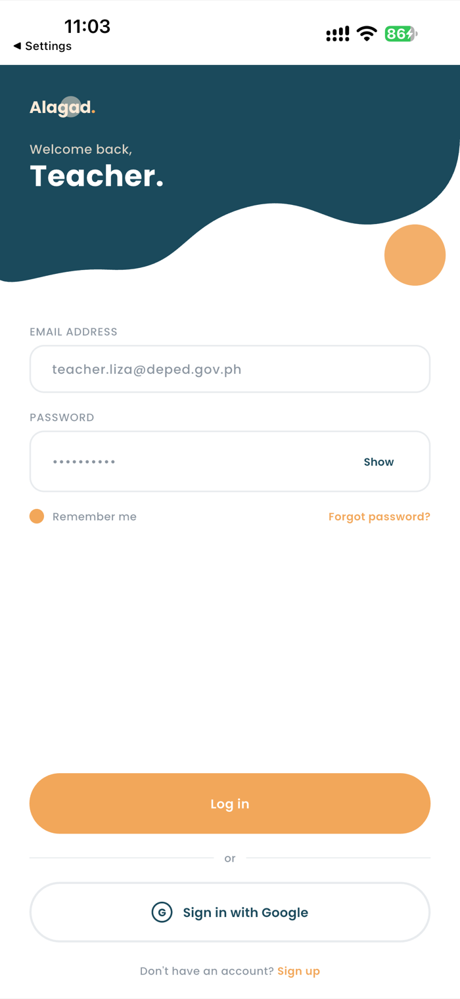
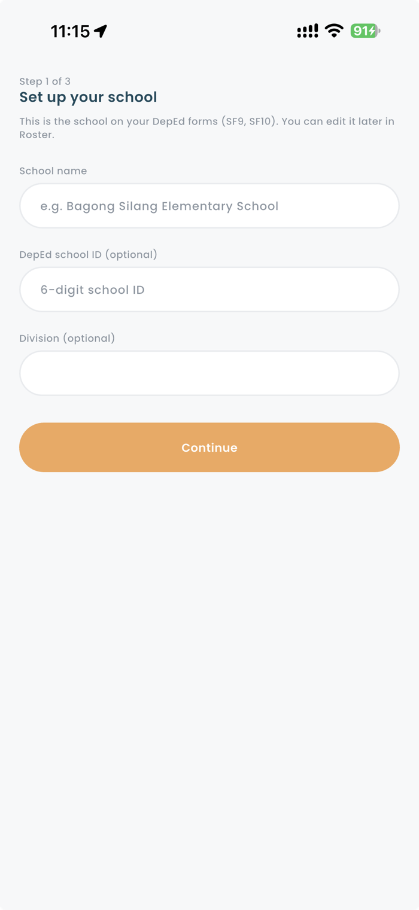
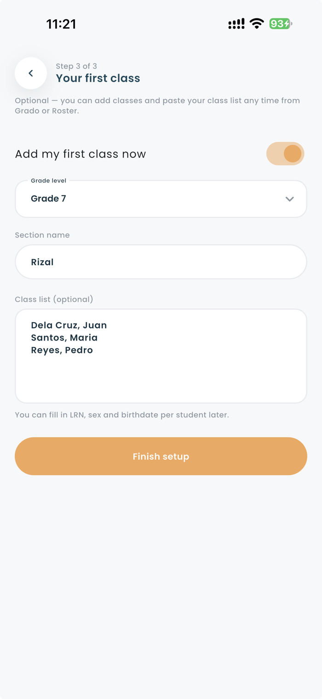
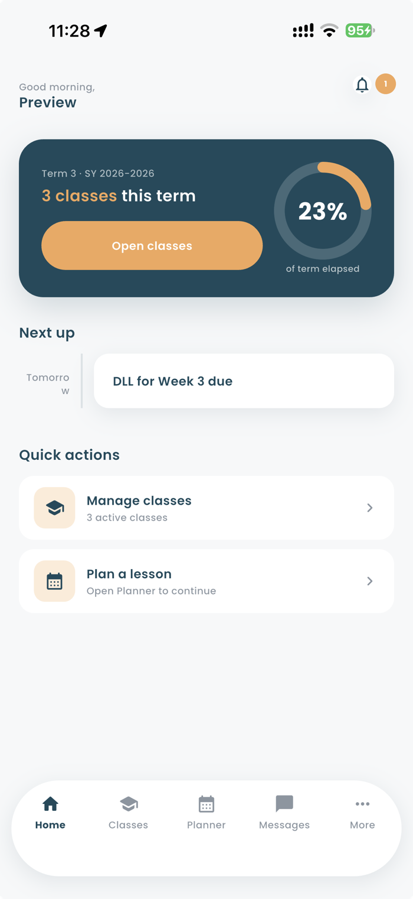
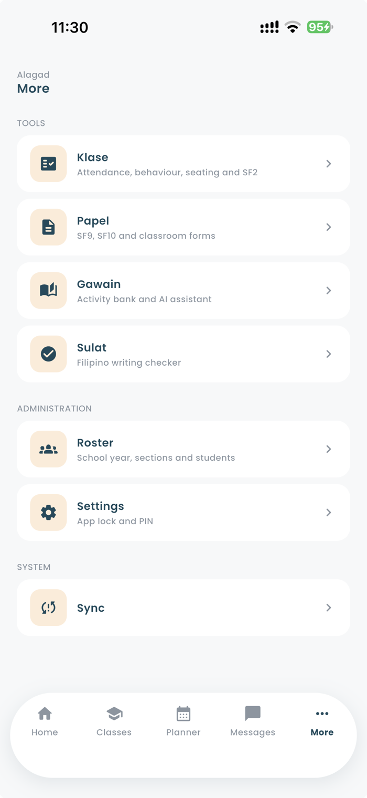
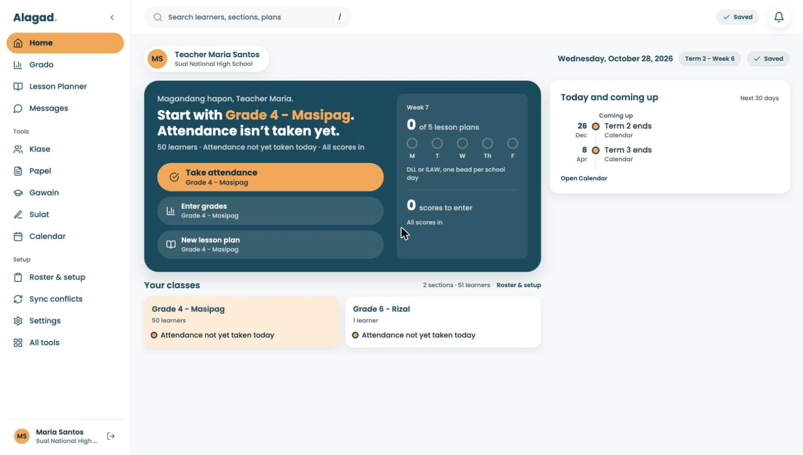
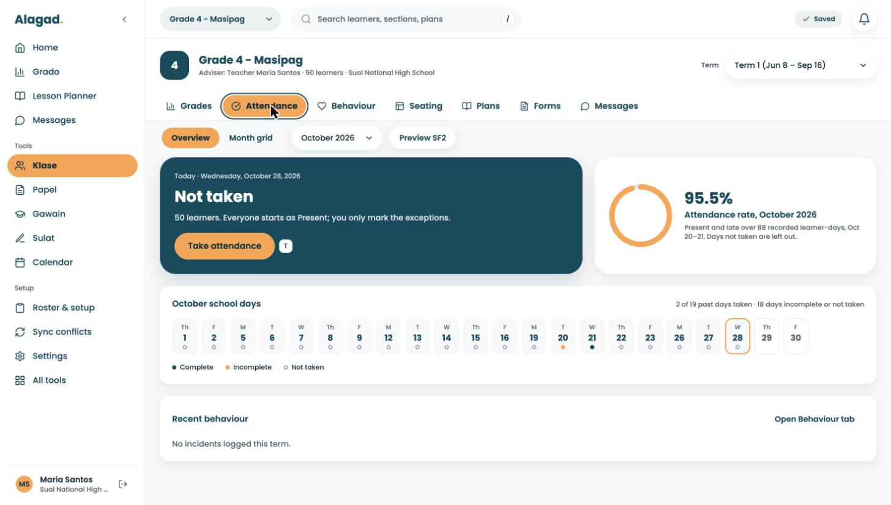
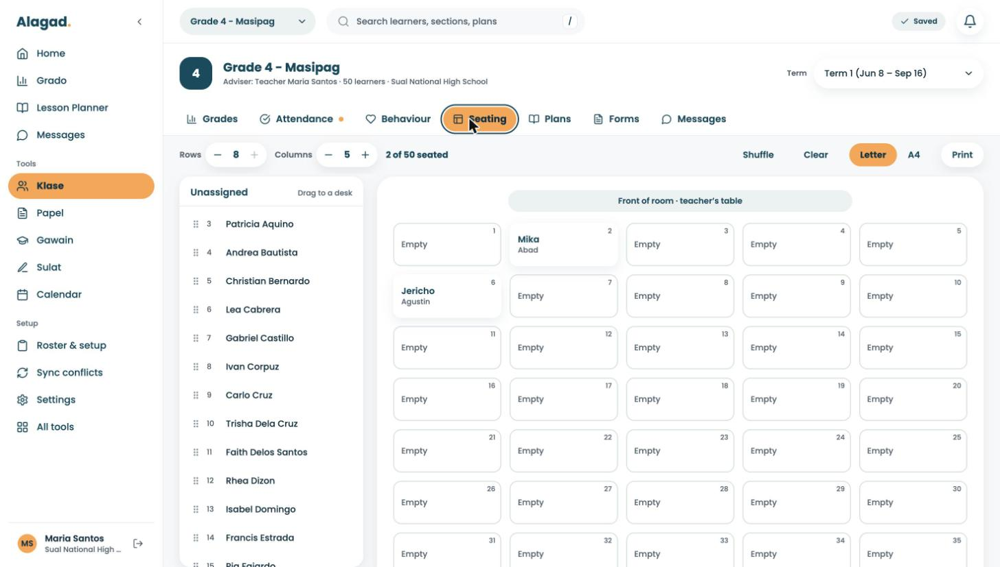
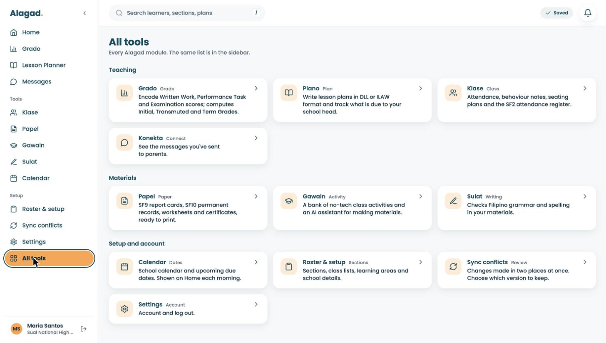
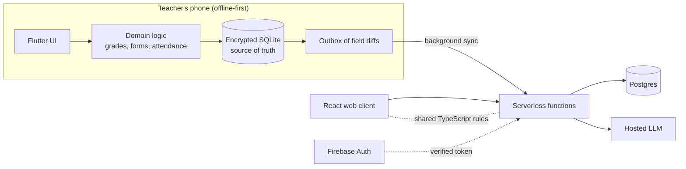

# Alagad: an offline-first toolkit for Filipino public school teachers

> **Case study.** Alagad ("Katuwang sa Pagtuturo", *a teaching partner*) is a product I design and build. The source code is private; this repository documents what it is, how it works and why it is built the way it is.

Teachers in large public-school classes (40 to 50 students is normal) spend hours on grade computation, attendance forms, lesson plans and DepEd paperwork, often on low-end phones with prepaid data and unreliable connections. Alagad puts those jobs in one app that works fully offline and syncs quietly in the background.

<table>
  <tr>
    <td></td>
    <td></td>
    <td></td>
    <td></td>
    <td></td>
  </tr>
</table>

Mobile app. Screenshots use sample data (a fictional teacher and school). More in [`assets/screenshots/`](assets/screenshots).

## What it does

| Module | What it covers |
|---|---|
| **Grado** | Grade computation and transmutation, quiz and exam creation, descriptive grading for the early grades, senior high school summaries |
| **Plano** | Daily lesson logs and lesson plans, with a competency picker for Grades 4 to 10 |
| **Klase** | Attendance, behaviour log, seating chart, SF2 export |
| **Papel** | Auto-filled school forms (SF9, SF10), worksheets, certificates, PDF preview |
| **Sulat** | Filipino spelling and grammar checker, with an optional AI "deep check" |
| **Gawain** | Offline activity bank and an AI assistant for learning materials |
| **Konekta** | Parent messaging log |
| **Roster & Sync** | School year, sections and students; conflict inbox; settings and app lock |

## The web client

The same product also runs in the browser, live at [alagad.web.app](https://alagad.web.app/) (sign-in required). It is a React, TypeScript and Vite single-page app on the same backend, built for the desktop: a sidebar shell, a class workspace per section (grades, attendance, behaviour, seating, plans, forms, messages), and keyboard shortcuts for fast entry.

<table>
  <tr>
    <td> Home: the next thing to do for a class</td>
    <td> Attendance: everyone starts present, mark the exceptions</td>
  </tr>
  <tr>
    <td> Seating chart for a 50-learner class</td>
    <td> All tools: every module in one place</td>
  </tr>
</table>

Demo account with fictional teacher and learner names.

What makes the web client more than a port:

- **Shared rules, not a rewrite.** Grade computation, roster parsing and the sync merge rules are plain TypeScript that runs in the browser and in the serverless functions, and each is checked against the Dart implementation with golden fixtures.
- **Honest sync states.** The header always says one of four things: Saved, Saving, Offline with a count of waiting changes, or Conflict with a count to review.
- **Features ship behind flags.** Write surfaces such as seating, quiz papers and evidence photos were enabled one at a time, and a surface that is off is hidden rather than shown disabled.
- **A written design system.** Tokens, component states, layout rules and a per-screen spec with a conformance checklist, enforced by a test that fails when the spec and the CSS variables drift.

## How it is built

| Layer | Choices |
|---|---|
| Mobile | Flutter, Riverpod, Drift over encrypted SQLite |
| Web | React, TypeScript, Vite, React Router |
| Backend | Postgres, serverless functions and storage on Supabase; Firebase Auth for sign-in |
| AI | Server-side calls to a hosted LLM; keys never reach a client |
| Quality | GitHub Actions (analyze, format, tests, web and function jobs), automatic web deploy after CI passes |

## Engineering decisions worth reading

**1. The device is the source of truth.** Every screen on the phone reads and writes the local database; saving a grade never waits on the network. Sync is a background layer that sends field-level diffs from an outbox (low data use on prepaid plans) and pulls changes with tombstones for deletes.

**2. Grades are never silently overwritten.** Most data merges with last-write-wins per field. Scores, attendance and descriptive grades are different: they are append-only protected. If a pulled value differs from a value the teacher recorded, the app creates a conflict for a person to resolve in an inbox instead of choosing a winner. Resolving writes the chosen value through the normal write path, so it syncs like any other edit.

**3. Regulations are configuration, not code.** Grading weights, transmutation tables, form templates and competency lists are versioned JSON files loaded at runtime (77 so far). A new DepEd order becomes a new versioned file and a small engine change, never an overwrite of the old rules, so earlier school years keep computing the way they did. A correction within the same order needs no app release: the corrected file is published to a registry and phones re-check it periodically, falling back to the bundled copy if the fetch fails.

**4. One rule set, two runtimes.** The Dart engine on mobile is the source of truth, and the web client uses a TypeScript port. Parity is enforced with golden fixtures: one side writes expected results, the other must reproduce them, and CI fails when they drift. Some fixtures flip direction where the web's logic is richer, which is recorded explicitly.

**5. Built for the devices teachers actually have.** Targets drive the design: cold start under 3 seconds, small sync payloads, an APK around 40 MB, and virtualized lists for 50-student classes.

**6. Conservative AI.** Grammar checking is a deterministic rule engine first, tuned to prefer a missed correction over a wrong one. The LLM "deep check" is optional, runs server-side with a per-teacher quota, and the app never trusts offsets from model output: it re-anchors each flagged span against the text on the device.

**7. Security by default.** The local database is encrypted with a key held in the platform keystore, the server verifies the identity token on every call and derives the teacher from it, every query is scoped to that teacher, and secrets never ship in a client.

## Process and quality

- A written design system and UI specification for the web client, with a conformance checklist, so screens are built to rules rather than taste.
- Every change is a tracked task; finished tasks are archived with a record of what was verified.
- Pure domain logic is separated from UI and storage so it can be unit tested without a device.

## By the numbers

| | |
|---|---|
| Time | First commit mid-August 2026; about 420 commits over roughly ten weeks |
| Mobile | about 250 Dart files, roughly 41,000 lines (excluding generated code) |
| Web and server | about 540 TypeScript files, over 100,000 lines including tests |
| Tests | about 300 test files (106 Dart, 203 TypeScript) |
| Backend | 8 serverless functions, 17 database migrations |
| Rules | 77 versioned DepEd configuration files |
| Work tracked | 226 completed tasks |

## Status

The React web client is the active surface. The Flutter mobile app reached broad feature coverage and is paused while the web client catches up.

## What is not in this repo

The application source, the backend schema, deployment details, user data and anything from real classrooms. Screenshots show sample data only. Happy to walk through the code in an interview.

## About

Built by **Mark Angelo Sabado**. More of my work: [github.com/mackyten](https://github.com/mackyten).

&copy; 2026 Mark Angelo Sabado. All rights reserved. Text and images in this repository may not be reused without permission.
